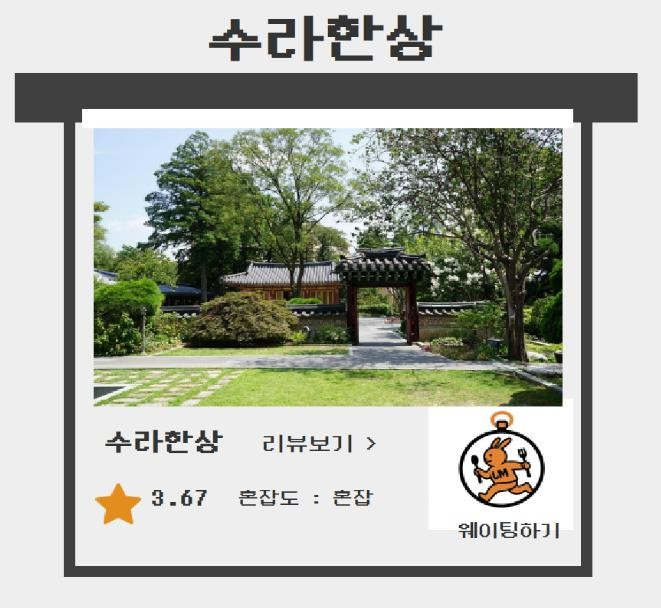
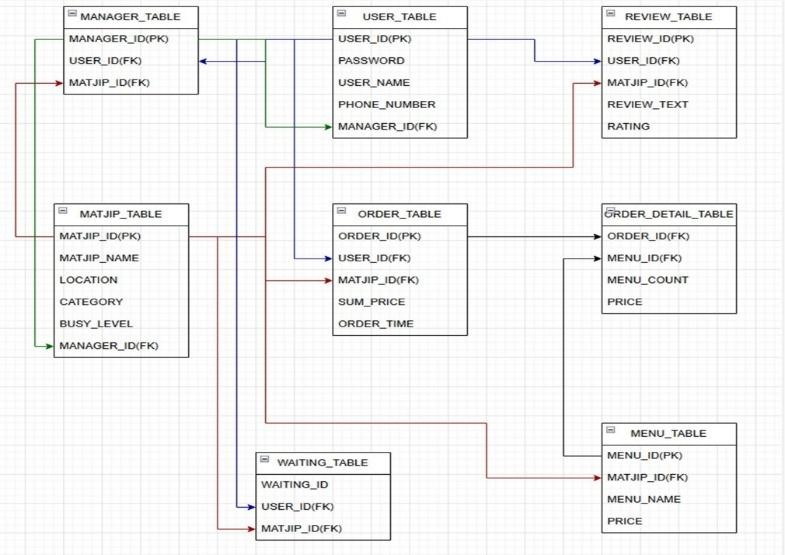

# MatjipON - 식당 웨이팅/예약 관리 프로그램

식당의 웨이팅, 예약, 주문, 결제 정보를 통합 관리하는 Java Swing 기반 데스크톱 프로그램입니다.
맛집 탐색, 대기, 예약, 결제를 각각 다른 앱으로 처리해야 하는 불편을 줄이기 위해 기획했습니다.

- GitHub: https://github.com/kimseoyeon6465/MatjipON
- YouTube: https://www.youtube.com/watch?v=3oiHsrP-0ZQ
- 포트폴리오: https://github.com/kimseoyeon6465/Portfolio

## 프로젝트 개요

| 항목 | 내용 |
|---|---|
| 기간 | 2025.04.15 ~ 2025.04.28 (약 2주) |
| 인원 | 4명 (팀 프로젝트) |
| 담당 | 대기 순번 관리 / 키오스크 주문 저장 / 리뷰와 별점 조회 / DB 모델링 |

## 주요 기능

- 사용자: 대기 등록과 취소, 대기 현황 조회, 키오스크 주문, 리뷰와 별점 작성
- 관리자: 대기 관리, 리뷰 관리

## 기술

Java, Java Swing, JDBC, Oracle, SQL, JFreeChart, Eclipse

## 담당

- 대기 등록 및 순번 관리: 취소, 삭제 시 ROW_NUMBER()로 대기 순번(waiting_id) 재정렬
- 키오스크 주문 저장: 주문을 ORDER_TABLE과 ORDER_DETAIL_TABLE에 저장하고 주문번호 기준으로 영수증 형태 조회
- 리뷰 등록, 조회, 삭제와 매장별 평균 별점 조회, 관리자 리뷰 관리와 혼잡도 반영
- Oracle DB 모델링, JDBC 연동, 예외 처리

## 핵심 구현

- **웨이팅 순번 관리:** 등록 시각(INSERT_TIME) 기준으로 ROW_NUMBER()를 적용해 순번을 다시 매깁니다. 삭제 후에는 DB를 다시 조회해 화면과 DB 상태를 맞춥니다.
- **키오스크 주문 저장:** 주문 단위와 메뉴 단위로 나누어 두 테이블에 저장하고, 주문번호로 조회해 JTable로 영수증 형태로 출력합니다.
- **평균 별점 조회:** 별점 평균을 저장하지 않고, 조회할 때 `AVG(RATING)`으로 계산해 표시합니다.

## 트러블슈팅

| 문제 상황 | 원인 분석과 시도 | 해결 결과 |
|---|---|---|
| 마감 직전, 키오스크 화면(메뉴 버튼 8개)만 있고 DB 연결이 없던 기능을 인수 | 설명 없이 넘겨받은 코드를 직접 읽어 구조 파악. 메뉴 번호 1~8 하드코딩, 매장 5곳으로 관리할 변수가 40개 | 변수를 배열로 정리하고 DB 연동과 주문 저장까지 연결. 마감 기한 안에 완성 |

## 화면과 ERD

## 성과 및 아쉬운 점

- 대기 순번 재정렬, 키오스크 주문 저장과 영수증 조회, 평균 별점 조회를 구현했습니다.
- 마감 직전에 인수한 키오스크 기능을 DB 저장까지 연결해 마감 안에 완성했습니다.
- 키오스크 주문은 메뉴와 금액을 DB에 저장하는 데까지 구현했고, 결제 모듈 연동과 입장 알림은 구현하지 못했습니다.

## 실행 환경

- Java, Eclipse 프로젝트 (콘솔이 아닌 Swing 창으로 실행, 시작 화면은 `loginUser.Main`)
- Oracle, 접속 정보는 `matjipDBC/MatjipDBC.java`에서 로컬 DB에 맞게 수정 (기본값 `127.0.0.1:1521:xe`)
- 필요 라이브러리: ojdbc8, JFreeChart(jfreechart, jcommon), JGoodies Forms, JGoodies Common
- 테이블 생성 스크립트는 저장소에 포함하지 않았고, ERD 이미지를 참고해 구성합니다.
